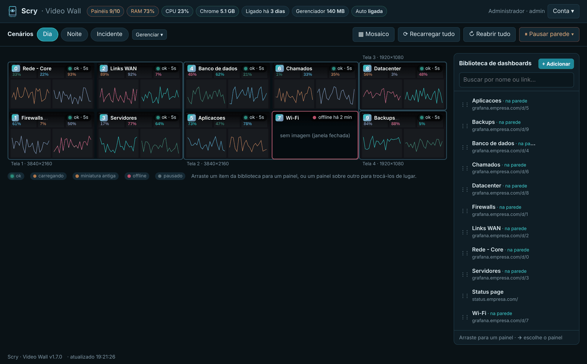
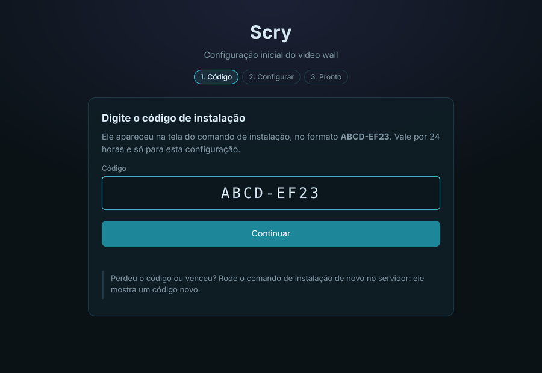
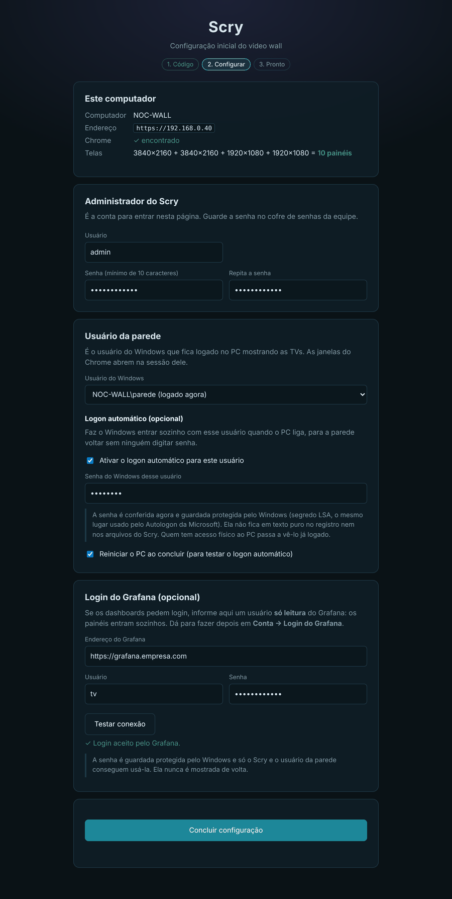
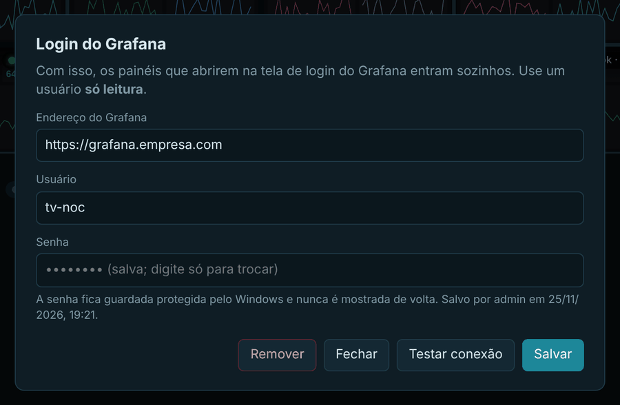
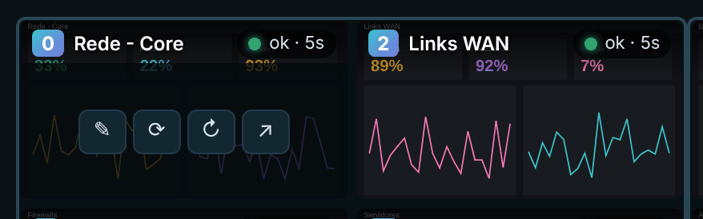

# Scry · Video Wall

O **Scry** controla as TVs do NOC pelo navegador. Ele roda num PC Windows ligado às TVs, abre um Chrome em cada painel e dá uma página web para a equipe trocar o que cada TV mostra, sem ir até o PC.



## Instalar

No PC das TVs, abra o **Prompt de Comando como Administrador** (ou entre por SSH com um administrador) e cole:

```
curl.exe -fsSL https://raw.githubusercontent.com/efbecker/nocwall/main/install.ps1 | powershell -NoProfile -ExecutionPolicy Bypass -Command -
```

Ele instala sozinho, sem perguntas (inclusive o Google Chrome, se faltar), e no fim mostra um endereço e um código:

```
        https://192.168.0.40

        Código de instalação:  K7QM-3XPA
```

Depois, de qualquer PC da rede:

1. Abra o endereço. O navegador avisa sobre o certificado: clique em **Avançado → Continuar**.
2. Digite o código.
3. Preencha a senha do administrador, escolha o usuário do Windows que fica nas TVs e clique em **Concluir configuração**.

| Passo 1: o código | Passo 2: a configuração |
|---|---|
|  |  |

Pronto. Entre no Windows com o usuário da parede (ou marque o **logon automático** no assistente) e as janelas abrem sozinhas, uma por painel. Reinicie o PC uma vez para ver tudo voltar sozinho.

### Antes de instalar

- Windows 10, 11 ou Server 2019+. O **Google Chrome** é instalado sozinho se não houver.
- Um usuário do Windows para as TVs (ex.: `parede`).
- Em **Configurações → Sistema → Tela**: telas na mesma posição da parede, **escala 100%** e resolução nativa. Em **Energia**: nunca desligar a tela nem suspender.
- O Scry usa **todos os monitores** do Windows (modo Estender): cada saída Full HD vira 1 painel e cada 4K vira 4 (ex.: 3 saídas 4K + 4 Full HD = 16 painéis). Ligou ou tirou um monitor, a grade se ajusta sozinha em até 5 minutos.

<details>
<summary>Outras formas de instalar</summary>

**Pelo PowerShell** (mesmo resultado; funciona também no Prompt de Comando):

```
powershell -NoProfile -ExecutionPolicy Bypass -Command "[Net.ServicePointManager]::SecurityProtocol='Tls12'; irm https://raw.githubusercontent.com/efbecker/nocwall/main/install.ps1 | iex"
```

**Sem internet, ou com nome no DNS e certificado `.pfx` próprio:** baixe o `Scry-vX.Y.Z.zip` em [Releases](../../releases), clique com o botão direito → **Propriedades → Desbloquear**, extraia e dê dois cliques em **`INSTALAR.cmd`**. Ele faz as perguntas no próprio terminal.

Opções avançadas (portas, redes permitidas): [NOC/INSTALAR.md](NOC/INSTALAR.md).

</details>

## Login do Grafana

Se os dashboards pedem login, informe um usuário **só leitura** no assistente ou depois em **Conta → Login do Grafana**. Use **Testar conexão** e **Salvar**: os painéis entram sozinhos em até 1 minuto. A senha fica protegida pelo Windows e nunca é mostrada de volta.



## Outros sites (BOSS, OpenFlow…)

A biblioteca aceita qualquer site, não só Grafana: em **+ Adicionar**, cole o link da tela que deve ficar na parede.

Se o site pede login, um admin cadastra em **Conta → Logins de sites**: nome, endereço (o começo dos links, ex.: `http://10.20.20.6/boss`), usuário e senha. Quando um painel desse endereço mostrar um campo de senha, o Scry preenche usuário e senha, marca "Lembrar-se de mim" e clica em entrar. Isso também resolve a sessão que expira no meio do dia.

- A senha fica protegida pelo Windows (DPAPI), num arquivo que só SYSTEM e Administradores leem, e nunca é mostrada de volta. Ela só é entregue a uma página que está no endereço cadastrado.
- Vários painéis do mesmo site com o mesmo login dividem uma única sessão: só um entra e os outros recebem a sessão dele. Isso evita o "loga e desloga" de sites que aceitam uma sessão por usuário, como o BOSS.
- Para um usuário diferente em cada painel, cadastre um login por painel com o mesmo endereço e preencha **Só nos painéis** (ex.: `12`).
- Se o login não sair da tela depois de 3 tentativas, o Scry para por 30 min (para não bloquear a conta no AD) e avisa na auditoria. **Entrar agora** tenta de novo na hora.
- Use um usuário só leitura, criado só para a parede. Em sites `http://` a senha passa pela rede sem criptografia.
- Não funciona com código extra (2FA) ou captcha. Se o Scry não achar os campos sozinho, preencha os seletores em **Avançado**.
- Sem cadastrar nada, também dá para entrar uma vez pela própria parede: o Chrome de cada painel guarda a sessão.

## Usar

- **Trocar um dashboard:** passe o mouse num painel e clique em ✎ **Editar**, ou arraste um item da **Biblioteca** para o painel.
- **Cenários:** salve a parede inteira (ex.: *Dia*, *Noite*, *Incidente*) e aplique com um clique. Trocou um painel? Clique em **💾 Salvar cenário** (aparece ao lado dos cenários) para a troca ficar no cenário.
- **Rodízio de cenários:** a parede troca de cenário sozinha (ex.: *ARMAZEM* 5 min, *PLATINUM* 2 min), com pré-carga escondida, pausa automática quando um painel fica vermelho, agenda por horário e botões ⏸ Pausar e ⏭ Próximo.
- **Mosaico:** junte painéis vizinhos numa tela maior.
- **Pausar a parede** por um tempo, **recarregar** ou **reabrir** tudo.
- **Grafana em tela cheia:** os links de dashboard (`/d/...`) abrem com `kiosk`, sem o menu lateral. Para outro modo, escreva o `kiosk` no próprio link. O balão do Google Tradutor fica desligado nas telas.
- **Usuários** com papéis `admin`, `operador` e `visualizador`, e auditoria de tudo.



O Scry também se corrige sozinho: reabre janelas travadas, recarrega páginas com erro, refaz o login do Grafana e reabre tudo uma vez por dia. Detalhes: [NOC/LEIAME.md](NOC/LEIAME.md). Monitoração pelo Zabbix: [zabbix/](zabbix/LEIAME.md).

## Atualizar

Rode **o mesmo comando** da instalação. Ele faz backup, atualiza e mantém painéis, usuários e auditoria. Para voltar à versão anterior:

```
powershell -ExecutionPolicy Bypass -File C:\NOC\Update-NocManager.ps1 -Reverter
```

## Problemas comuns

| Sintoma | O que fazer |
|---|---|
| "Abra o PowerShell como Administrador" | abra o terminal com *Executar como administrador* |
| O comando não mostra nada | o PC não alcança o GitHub; teste `curl.exe -I https://raw.githubusercontent.com` ou use o `INSTALAR.cmd` |
| "O pacote baixado é a v1.5.x…" | o último Release é antigo; crie um Release novo (veja abaixo) |
| "Código inválido ou vencido" | rode o comando de instalação de novo: ele mostra outro código |
| Faixa vermelha "Chrome não instalado" | rode o comando de instalação de novo (ele instala o Chrome) e clique em **Reabrir tudo** |
| Faixa vermelha "Usuário da parede não está logado" | entre no Windows com o usuário da parede (ou ative o logon automático) |
| Painéis na tela de login do Grafana | **Conta → Login do Grafana → Testar conexão** |
| Painel de outro site parado na tela de login | **Conta → Logins de sites**: confira usuário e senha e clique em **Entrar agora**; veja a coluna "Na parede agora" |
| Janelas do Chrome não abrem | confira o logon automático e a tarefa `NOC-VideoWall` no *Agendador de Tarefas* |
| A página não abre | veja `C:\NOC\Manager\diag.log` e a tarefa `NOC-Manager` |
| Esqueci a senha do `admin` | `powershell -ExecutionPolicy Bypass -File C:\NOC\Manager\NocManager.ps1 -NovoAdmin admin` |

Mais casos: [NOC/LEIAME.md](NOC/LEIAME.md#problemas-comuns). Desinstalar: `powershell -ExecutionPolicy Bypass -File C:\NOC\Install-NocManager.ps1 -Remover`.

---

## Para quem mantém o projeto

- **Nova versão:** mude `$Version` em `NOC/Manager/NocManager.ps1` e crie um Release com a tag `vX.Y.Z` (aba **Releases → Draft a new release**). O GitHub Actions gera o `Scry-vX.Y.Z.zip` e anexa ao Release. Crie o Release **depois** do merge, com o alvo na `main` atual: o Actions confere se a tag bate com o `$Version` e falha se não bater. O comando de instalação sempre baixa o último Release.
- **Gerar o pacote à mão** (Windows): `powershell -ExecutionPolicy Bypass -File .\Build-Pacote.ps1` (sai em `dist\`).
- Os `.ps1` precisam ficar em **ASCII** (sem acentos): o Windows PowerShell 5.1 lê UTF-8 sem BOM como ANSI. O workflow falha se achar acento.

| Pasta/arquivo | O que tem |
|---|---|
| `install.ps1` | o comando de instalação: só baixa e roda o `scripts/install-scry.ps1` |
| `scripts/install-scry.ps1` | o instalador de verdade (baixa o Release, instala ou atualiza, mostra o código) |
| `INSTALAR.cmd` | instalar pelo pacote, com dois cliques |
| `NOC/` | o programa, que vai para `C:\NOC` ([uso](NOC/LEIAME.md), [instalação detalhada](NOC/INSTALAR.md)) |
| `docs/img/` | imagens deste README |
| `zabbix/`, `brand/` | template de monitoração e identidade visual |
